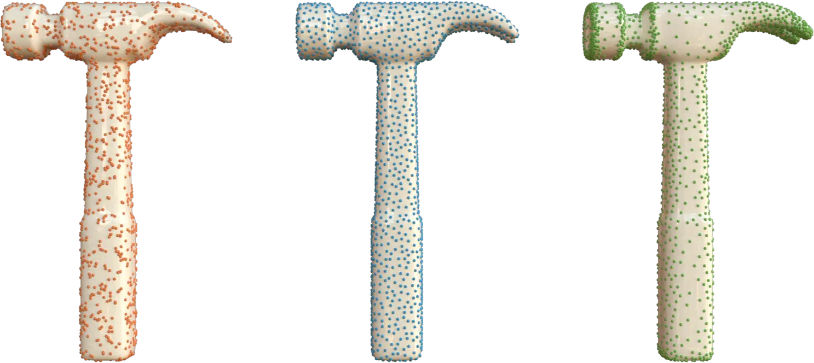

<!-- $ignore -->

# Sampling



The sampling module generates points on triangle mesh surfaces. It returns sample positions and
source facet indices without modifying the input mesh.

- [`sample_uniform`](#uniform-random-sampling): independent, area-uniform random points. The count
  is specified by `num_samples`.
- [`sample_blue_noise`](#blue-noise-sampling): a more evenly spaced point set, optionally guided by
  a density field. The count is specified by `num_samples`.
- [`sample_epsilon`](#epsilon-sampling): spacing controlled by a local feature size (LFS) field.
  The count is computed from `epsilon` and the LFS field.

## Build and Input Requirements

```cmake
lagrange_include_module(sampling)
target_link_libraries(my_target PRIVATE lagrange::sampling)
```

All three functions accept a `lagrange::SurfaceMesh<Scalar, Index>` containing triangles, in 2D or
3D. For 2D meshes, sampling requires positive facet area. If the input mesh is polygonal, first call
[`lagrange::triangulate_polygonal_facets`](../core/mesh-utilities.md#triangulate-polygonal-facets).

The examples below use a unit square split into two triangles:

```c++
#include <lagrange/SurfaceMesh.h>

#include <cstdint>

using Scalar = double;
using Index = std::uint32_t;

lagrange::SurfaceMesh<Scalar, Index> mesh;
mesh.add_vertex({0, 0, 0});
mesh.add_vertex({1, 0, 0});
mesh.add_vertex({1, 1, 0});
mesh.add_vertex({0, 1, 0});
mesh.add_triangle(0, 1, 2);
mesh.add_triangle(0, 2, 3);
```

Set `seed` to reproduce a sampling run with the same mesh and options. Its default is `0`.

## Uniform Random Sampling

`sample_uniform` selects triangles in proportion to their area and draws points uniformly within
each selected triangle. Larger triangles receive more samples on average; this is not uniform
sampling over facet indices. Points are independent, so local clusters and gaps are expected.

```c++
#include <lagrange/sampling/sample_uniform.h>

lagrange::sampling::UniformSamplingOptions uniform_options;
uniform_options.num_samples = 1000;
uniform_options.seed = 42;

const auto uniform = lagrange::sampling::sample_uniform(mesh, uniform_options);
```

`num_samples` must be greater than zero. The C++ result contains:

- `samples`: flat positions of size `num_samples * mesh.get_dimension()`, ordered as
  `x0, y0, z0, x1, y1, z1, ...` for a 3D mesh.
- `facet_indices`: one source triangle index per sample.

For sample `i`, coordinate `d` is `uniform.samples[i * mesh.get_dimension() + d]`, and its source
triangle is `uniform.facet_indices[i]`.

## Blue-Noise Sampling

`sample_blue_noise` first generates an oversampled uniform point cloud, then eliminates crowded
points until the requested count remains. It uses the sample-elimination method of
[Yuksel (2015)](https://www.cemyuksel.com/research/sampleelimination/).

```c++
#include <lagrange/sampling/sample_blue_noise.h>

lagrange::sampling::BlueNoiseSamplingOptions<Scalar, Index> blue_options;
blue_options.num_samples = 1000;
blue_options.seed = 42;

const auto blue = lagrange::sampling::sample_blue_noise(mesh, blue_options);
```

Without a density specification, the distribution has uniform density. The result contains
`samples` and `facet_indices` with the same layout as uniform sampling, plus one `densities` value
per sample. These are the original evaluated density values, not normalized values or the
bias-adjusted targets. With uniform density, all values are `1`.

### Density Attributes

Set `density` to the name of a mesh attribute to concentrate samples where its values are larger.
The attribute must be single-channel, per-vertex or per-facet, and have the same value type as the
mesh's `Scalar`. Per-facet density is constant within a triangle; per-vertex density is
barycentrically interpolated at each candidate position.

For example, assign higher density to the first triangle of the square:

```c++
#include <lagrange/Attribute.h>

#include <string_view>

const auto density_id = mesh.create_attribute<Scalar>(
    "density",
    lagrange::AttributeElement::Facet,
    1,
    lagrange::AttributeUsage::Scalar);
auto& density = mesh.ref_attribute<Scalar>(density_id);
density.ref(0) = 4.0;
density.ref(1) = 1.0;

blue_options.density = std::string_view("density");
const auto graded = lagrange::sampling::sample_blue_noise(mesh, blue_options);
```

Only relative density magnitudes matter: multiplying the field by a positive constant does not
change the target distribution. The density does not specify the total sample count.

Evaluated densities must be finite and non-negative, and their sum over candidates must be
positive. Invalid values throw `lagrange::sampling::DensityError`, declared in
`lagrange/sampling/DensityError.h`. In C++, `DensityError::status()` distinguishes
`DensityStatus::ContainsNonFiniteOrNan`, `ContainsNegative`, and `HasNonPositiveSum`.

### Density Callbacks (C++)

Instead of an attribute name, assign a `DensityCallback`. The callback receives a flat list of
candidate samples and their associated facet ids as input. It fills an output span of the same
size with one density per sample:

```c++
blue_options.density = [](lagrange::span<const Scalar> positions,
                          lagrange::span<const Index> facets,
                          lagrange::span<Scalar> output_densities) {
    // This example mesh is 3D. Increase density toward x = 1.
    for (size_t i = 0; i < facets.size(); ++i) {
        output_densities[i] = 1.0 + 3.0 * positions[3 * i];
    }
};
const auto procedural = lagrange::sampling::sample_blue_noise(mesh, blue_options);
```

The output density must satisfy the same density validity requirements as
the density attributes version. The Python binding accepts density attributes, not callbacks.

### Quality and Cost

| Option | Default | Effect and valid range |
| --- | --- | --- |
| `num_samples` | `0` | Required positive output count |
| `bias` | `0.0` | Blend from prescribed density (`0`) toward uniform density (`1`); finite, in `[0, 1]` |
| `oversample_ratio` | `8.0` | Candidate count is `ceil(oversample_ratio * num_samples)`; finite, at least `1` |
| `rmax_factor` | `4.0` | Scales the neighborhood used to compute elimination weights; finite and positive |

Increase `oversample_ratio` and `rmax_factor` together to reduce clumping at the cost of more
computation and memory. Increasing `bias` reduces density contrast and can also reduce clumping.
`rmax_factor` is not a guaranteed minimum sample separation, and a fixed-count blue-noise result
does not guarantee epsilon coverage.

## Epsilon Sampling

`sample_epsilon` uses variable-radius dart throwing, with local radius
$\epsilon\,\mathrm{lfs}(x)$, where $\mathrm{lfs}(x)$ is the local feature size (LFS) at point
$x$, and $\epsilon$ is a positive scaling factor.
LFS measures the distance from $x$ to the medial axis of the shape.
Narrow regions, such as the fingers of a human figure, have small LFS and therefore receive denser
sampling. Wide regions, such as the torso, have large LFS, resulting in coarser sampling.
Unlike blue-noise sampling, there is no target sample count.

To compute the LFS attribute, use `lagrange::raycasting::compute_local_feature_size` in the
raycasting module. Alternatively, any other distance-based field can replace LFS to guide sampling.

LFS is passed in as a single-channel, per-vertex mesh attribute. It must be strictly positive and
have the same value type as the mesh's `Scalar` type. LFS is linearly interpolated within each triangle.
Use a constant LFS field for fixed-radius sampling.

```c++
#include <lagrange/sampling/sample_epsilon.h>
#include <lagrange/raycasting/compute_local_feature_size.h>

auto lfs_id = lagrange::raycasting::compute_local_feature_size(mesh);
auto lfs_name = mesh.get_attribute_name(lfs_id);
auto epsilon = Scalar(0.5);

lagrange::sampling::EpsilonSamplingOptions<Scalar, Index> epsilon_options;
epsilon_options.ensure_vertex_coverage = true;
epsilon_options.compute_barycentric = true;

const auto epsilon_samples = lagrange::sampling::sample_epsilon(
    mesh, lfs_name, epsilon, epsilon_options);
```

Epsilon sampling can be controlled via `EpsilonSamplingOptions`, which provides the following
options:

| Option | Default | Effect |
| --- | --- | --- |
| `max_failed_attempts` | `1000` | Stop after this many consecutive rejected darts; must be positive |
| `compute_barycentric` | `false` | Include three barycentric coordinates per sample |
| `ensure_vertex_coverage` | `false` | Add uncovered facet-referenced vertices to the sample set |


!!! warning "Coverage is probabilistic"
    Finite dart throwing aims to put every surface point within its local `epsilon * lfs` radius of
    a sample, but does not guarantee full surface coverage. `ensure_vertex_coverage` ensures that
    facet-referenced vertices are covered; it does not guarantee coverage of triangle interiors or of
    isolated vertices. Neighborhood distances are Euclidean, not geodesic, so nearby sheets
    can influence each other's sampling.

The result contains flat `samples` and one `facet_indices` entry per accepted sample. The sample
count is `facet_indices.size()`. When requested, `barycentric` has `3 * facet_indices.size()`
entries; otherwise it is empty. The three weights follow the vertex order of the source triangle
and can be used to interpolate per-vertex attributes at a sample.

## Python

The Python API lives in `lagrange.sampling`. This runnable example uses the same square as the C++
examples:

```python
import lagrange
import numpy as np

mesh = lagrange.SurfaceMesh()
mesh.vertices = np.array(
    [[0.0, 0.0, 0.0], [1.0, 0.0, 0.0], [1.0, 1.0, 0.0], [0.0, 1.0, 0.0]],
    dtype=np.float64,
)
mesh.facets = np.array([[0, 1, 2], [0, 2, 3]], dtype=np.uint32)

uniform_points, uniform_facets = lagrange.sampling.sample_uniform(
    mesh, num_samples=1000, seed=42
)

mesh.create_attribute(
    "density",
    element=lagrange.AttributeElement.Facet,
    usage=lagrange.AttributeUsage.Scalar,
    initial_values=np.array([4.0, 1.0], dtype=np.float64),
)
blue_points, blue_facets, densities = lagrange.sampling.sample_blue_noise(
    mesh, num_samples=1000, seed=42, density_attribute="density"
)

mesh.create_attribute(
    "lfs",
    element=lagrange.AttributeElement.Vertex,
    usage=lagrange.AttributeUsage.Scalar,
    initial_values=np.full(mesh.num_vertices, 0.1, dtype=np.float64),
)
epsilon_points, epsilon_facets, barycentric = lagrange.sampling.sample_epsilon(
    mesh,
    lfs_attribute="lfs",
    epsilon=0.5,
    seed=42,
    compute_barycentric=True,
    ensure_vertex_coverage=True,
)

# Reconstruct epsilon sample positions from their source triangles and weights.
triangles = mesh.vertices[mesh.facets[epsilon_facets]]
reconstructed = np.einsum("ij,ijk->ik", barycentric, triangles)
assert np.allclose(reconstructed, epsilon_points)
```

Python returns tuples rather than the C++ result structs:

| Function | Return tuple |
| --- | --- |
| `sample_uniform` | `(samples, facet_indices)` |
| `sample_blue_noise` | `(samples, facet_indices, densities)` |
| `sample_epsilon` | `(samples, facet_indices, barycentric)` |

For `N` samples, `samples` is an `N x dimension` `float64` array and `facet_indices` is an `N`-entry
`uint32` array. Blue-noise `densities` is an `N`-entry `float64` array. Epsilon `barycentric` is an
`N x 3` `float64` array when requested, or an empty `0 x 3` array otherwise. Invalid blue-noise
densities raise `lagrange.sampling.DensityError`.

Python uses the same option names and defaults as C++, except that blue-noise density attributes
are selected with `density_attribute="name"`. Omit it (or pass `None`) for uniform density.

## API Reference

See the [sampling module headers]({{ repo_url }}/tree/main/modules/sampling/include/lagrange/sampling)
for complete C++ signatures and the [mesh attribute guide](../core/attributes.md) for creating and
accessing density and LFS fields.
